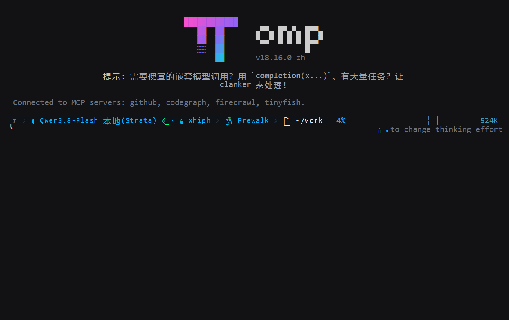
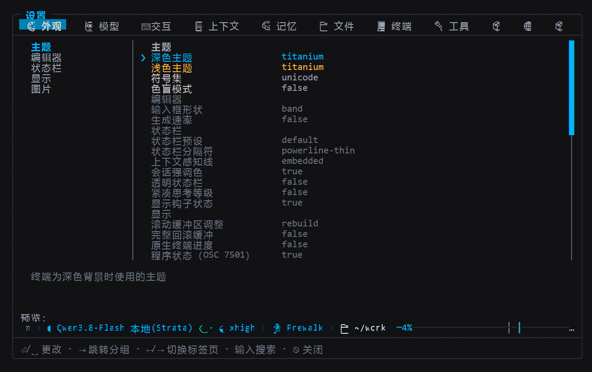
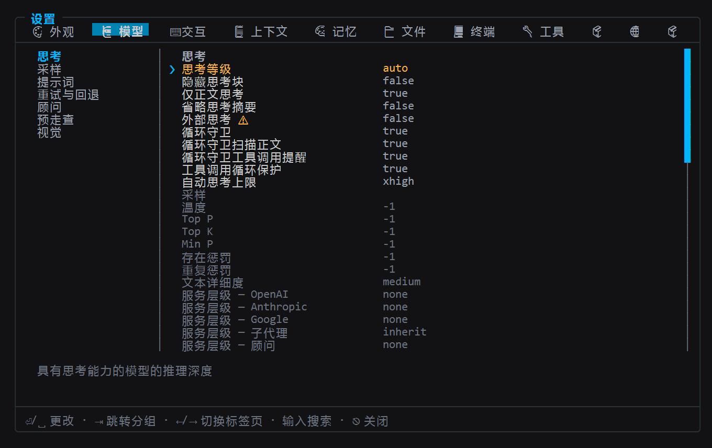
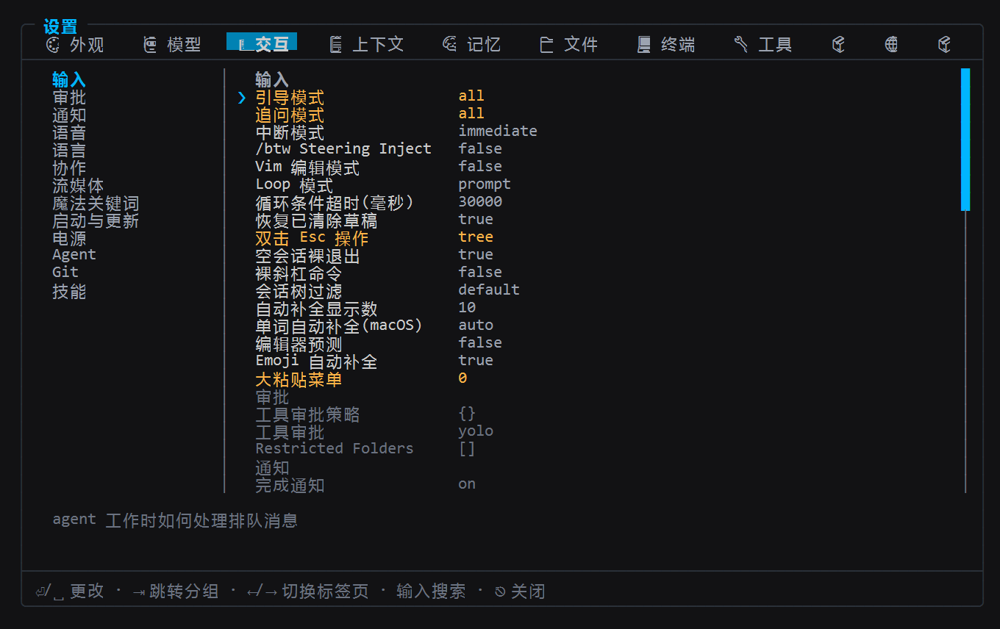
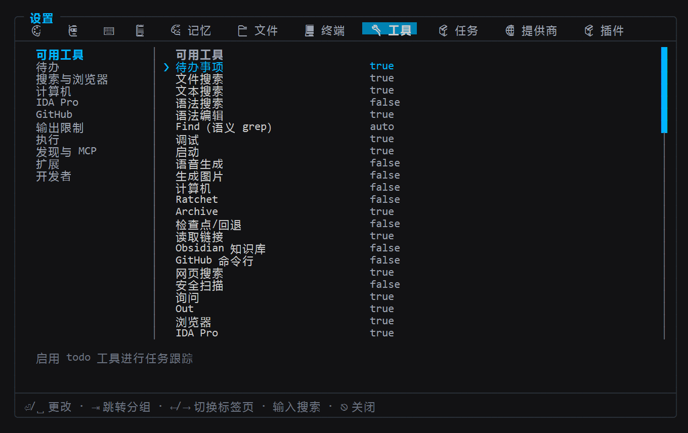

<p align="center">
  
</p>

# oh-my-pi-zh · Chinese localization of Oh My Pi

**This repository is the Chinese UI localization fork of [can1357/oh-my-pi](https://github.com/can1357/oh-my-pi) (omp), maintained by 木乙创设 MYC丨AIGC.** It does one thing: fully localize omp's interface into Chinese and ship a matching `-zh` build for every upstream release. The engine, tools, and model providers stay upstream's implementation — no features added, no behavior changed.

Language: **English** | [简体中文](README.zh-CN.md)

- **Current alignment**: upstream official **v18.16.0** (commit `650f3a10`), published as tag `v18.16.0-zh`
- **Release history and quality gates**: [CHANGELOG.zh.md](CHANGELOG.zh.md) (Chinese)
- **Language switch**: `OMP_LANG=zh` wins, then `i18n.language` in `~/.omp/agent/config.yml`; set `en` (or unset) to get upstream English

## Install (Windows x64 only)

Releases here publish **one asset: `omp-windows-x64.exe`** — there are **no Linux or macOS builds**.

1. Download `omp-windows-x64.exe` from [Releases](../../releases) (each release lists its SHA-256);
2. Put it on your `PATH` (rename to `omp.exe` if you like);
3. Run `omp` and follow the welcome screen to configure a model.

> [!WARNING]
> The upstream install methods — `curl -fsSL https://omp.sh/install`, `brew install can1357/tap/omp`, and the npm package `@oh-my-pi/pi-coding-agent` — all install the **upstream English omp**, not this fork. The Chinese build is only available from this repository's [Releases](../../releases), or by [building from source](#building-from-source).

## Chinese UI gallery

The screenshots below were captured live from `v18.16.0-zh` (Nov 2026): a real `omp` process was driven through a ConPTY and its 110×34 byte stream was replayed into a cell grid — no mockups, no redrawn text.

### Welcome screen


### Settings









## Localization scope

| Scope | Content |
| --- | --- |
| Localized | TUI (welcome screen and prompts, chat/tool renderers, overlays, settings UI, slash-command feedback), `omp --help` and all subcommand help, every `omp stats` dashboard page |
| Kept in English | Engine and tool behavior, brand names and model ids, literals like `true`/`false`; plain CLI data output deliberately stays as upstream |

English strings remain the source of truth; translation applies at the UI boundary (`interceptUIString` / `i18n.t` / the tui seam `tuiT`). No Chinese literals are sprinkled into source code.

## Relationship to upstream

- Upstream project: [can1357/oh-my-pi](https://github.com/can1357/oh-my-pi) · website [omp.sh](https://omp.sh) — feature tour, installation, and docs live there
- This fork **only localizes the interface**: no upstream bug fixes, no new features; each round aligns to the official `vX.Y.Z` tag and ships as `vX.Y.Z-zh`
- Mirrors: GitHub `feigo313/oh-my-pi-zh` · Gitee `atrix313/oh-my-pi-zh` (default branch `master` on both)

## Building from source

```sh
bun setup    # install dependencies and build the Rust native addon
bun run dev  # run omp from source
```

Requires Bun (upstream asks ≥ 1.4.4); set `OMP_LANG=zh` to see the Chinese UI. Repo structure, development, and contribution guidelines follow upstream docs (`CONTRIBUTING.md`, `packages/coding-agent/DEVELOPMENT.md`).

## License

Upstream omp is licensed under the [MIT License](https://github.com/can1357/oh-my-pi/blob/main/LICENSE); the translation files added by this repository are released under MIT as well.
