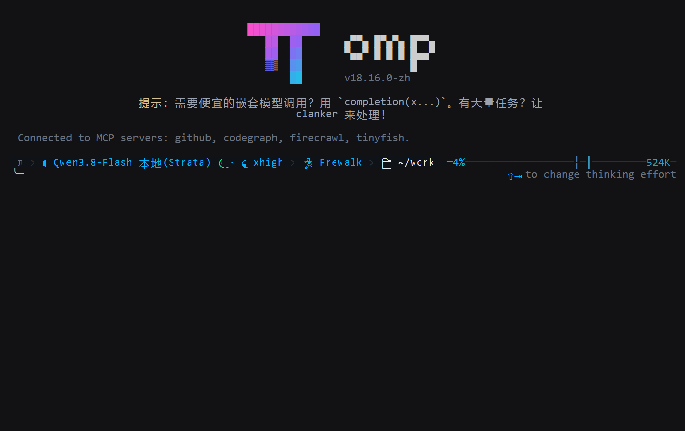
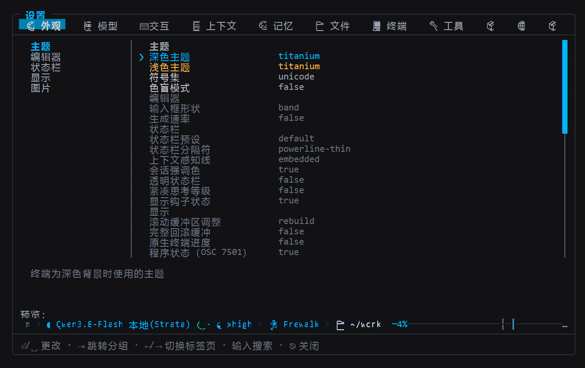
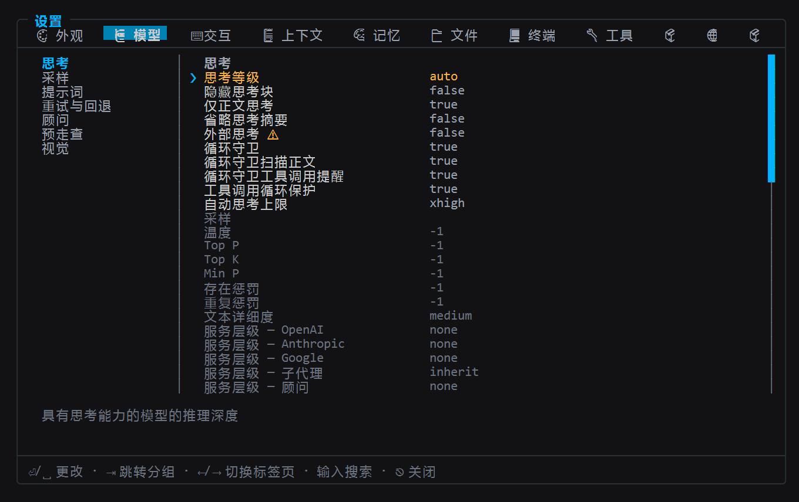
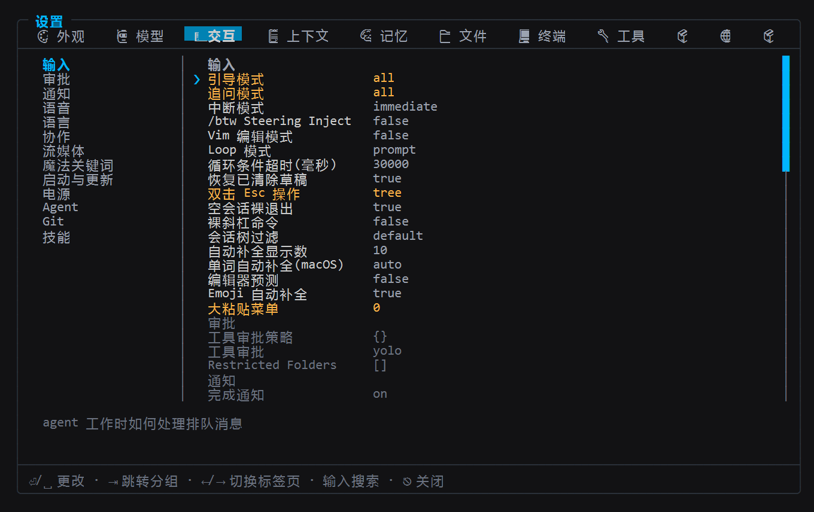
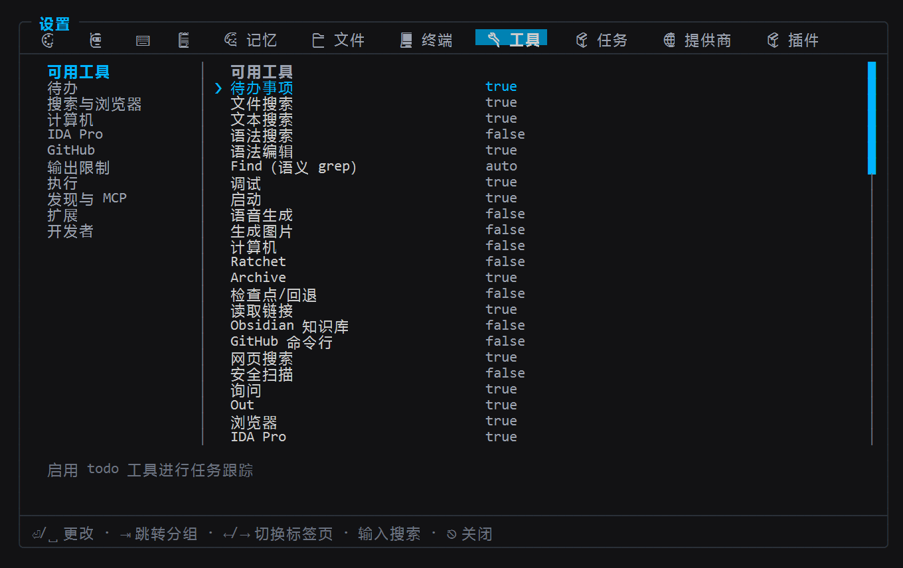

<p align="center">
  
</p>

# oh-my-pi-zh · Oh My Pi 中文汉化版

**本仓库是 [can1357/oh-my-pi](https://github.com/can1357/oh-my-pi)(omp)的中文界面汉化 fork，由 木乙创设 MYC丨AIGC 维护。** 这里只做一件事：把 omp 的界面完整汉化成中文，并跟随上游每个官方版本发布对应的 `-zh` 构建。引擎、工具与模型提供商全部保持上游实现——不加功能，不改行为。

Language: [English](README.md) | **简体中文**

- **当前对齐**：上游官方 **v18.16.0**（commit `650f3a10`），发布为 tag `v18.16.0-zh`
- **发布历史与质量校验**：[CHANGELOG.zh.md](CHANGELOG.zh.md)
- **语言切换**：`OMP_LANG=zh` 优先，其次 `~/.omp/agent/config.yml` 的 `i18n.language`；设为 `en` 即回到上游英文

## 安装（仅 Windows x64）

Releases 只发布**一个产物：`omp-windows-x64.exe`**——**没有 Linux / macOS 构建**。

1. 从 [Releases](../../releases) 下载 `omp-windows-x64.exe`（每个 Release 附 SHA-256）；
2. 放入 PATH 目录（可改名为 `omp.exe`）；
3. 运行 `omp`，按欢迎页提示配置模型。

> [!WARNING]
> 上游官方的安装方式 —— `curl -fsSL https://omp.sh/install`、`brew install can1357/tap/omp`、npm 包 `@oh-my-pi/pi-coding-agent` —— 安装的都是**上游英文版 omp**，与本仓库无关。中文版只能从本仓库 [Releases](../../releases) 获取，或按[从源码构建](#从源码构建)自行编译。

## 中文界面实拍

以下截图实拍于 `v18.16.0-zh`（2026-11）：用 ConPTY 驱动真实 omp 进程，抓取 110×34 终端字节流后逐单元格重建——不是设计稿，也不是贴图改字。

### 欢迎页


### 设置页









## 汉化范围

| 范围 | 内容 |
| --- | --- |
| 已汉化 | TUI 界面（欢迎页与提示、聊天/工具渲染器、覆盖层、设置界面、斜杠命令反馈）、`omp --help` 与各子命令帮助、`omp stats` 全部仪表盘页面 |
| 保持英文 | 引擎与工具行为、品牌名与模型 id、`true`/`false` 等字面量；CLI 纯数据输出刻意保持上游原文 |

翻译以英文原文为 source of truth，在 UI 边界（`interceptUIString` / `i18n.t` / tui seam `tuiT`）生效；源码字符串保持英文，不出现中文字面量。

## 与上游的关系

- 上游项目：[can1357/oh-my-pi](https://github.com/can1357/oh-my-pi) · 官网 [omp.sh](https://omp.sh)——功能介绍、安装方式与文档均以官方仓库为准
- 本 fork **只做界面汉化**：不修上游 bug、不新增功能；每轮对齐官方 `vX.Y.Z` tag，发布为 `vX.Y.Z-zh`
- 镜像：GitHub `feigo313/oh-my-pi-zh` · Gitee `atrix313/oh-my-pi-zh`（默认分支均为 `master`）

## 从源码构建

```sh
bun setup     # 安装依赖并构建 Rust 原生模块
bun run dev   # 从源码启动 omp
```

需要 Bun（上游要求 ≥ 1.4.4）；设置 `OMP_LANG=zh` 即可看到中文界面。仓库结构、开发与贡献规范以上游文档为准（`CONTRIBUTING.md`、`packages/coding-agent/DEVELOPMENT.md`）。

## License

上游 omp 采用 [MIT 协议](https://github.com/can1357/oh-my-pi/blob/main/LICENSE)；本仓库新增的翻译文件同样以 MIT 释出。
